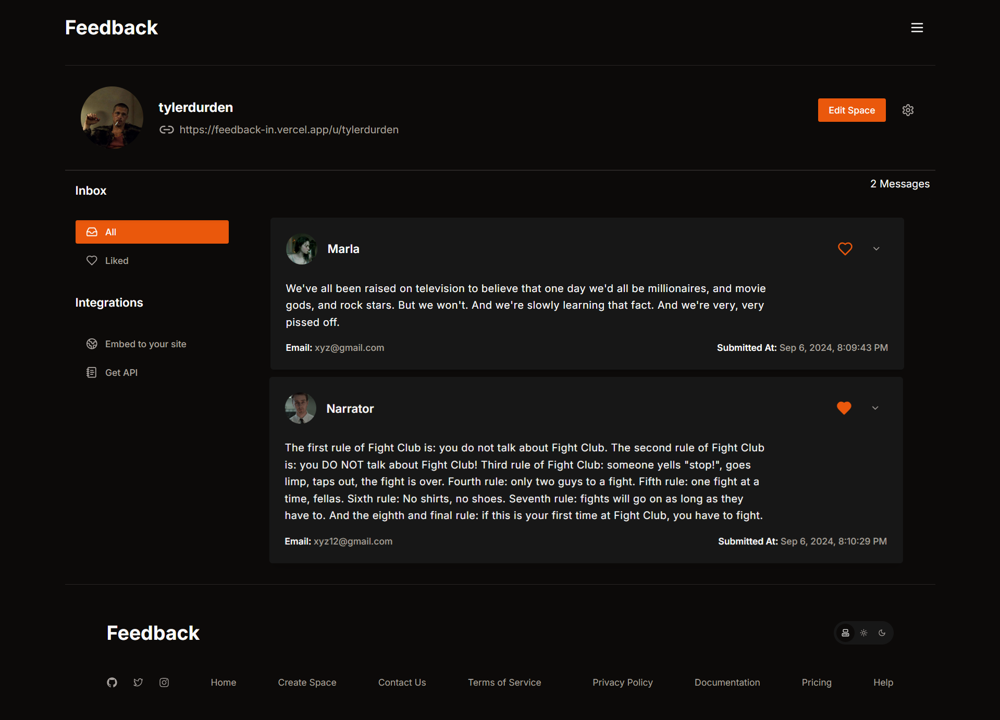

# Feedback

**Collect feedback from your customers and showcase the best of it on your website.**

Create a branded page for your business, share one link, and embed a live testimonial carousel anywhere with a copy-paste snippet.

[Live demo](https://feedback-in.vercel.app/) · [Report a bug](https://github.com/HmadAfzal/feedback/issues)




## How it works

1. **Create a space.** Set up a collection page for your business in a couple of minutes: name, image, headline, description, theme and button text.
2. **Share the link.** Send it by email, social media or SMS. Customers leave feedback on a clean public page, with an optional photo.
3. **Curate.** Review everything in one dashboard. Like the testimonials you want to feature, delete the rest.
4. **Embed.** Copy the generated snippet into your site. Your testimonials appear as a responsive carousel that stays in sync with your dashboard.

## Features

- **Branded collection pages** with a custom headline, description, image, light or dark theme, button text and thank-you message
- **Public submission form** with name, feedback, optional email and optional image upload (Cloudinary)
- **Central dashboard** to manage spaces and feedback: view, like, delete, edit and remove spaces
- **Embeddable carousel** with colour, date, card-height and shadow options, auto-resizing to fit your page
- **Social sign-in** with GitHub or Google (NextAuth)
- **Responsive UI** built with Tailwind CSS and shadcn/ui

## Embedding on your site

The dashboard generates the snippet for you with your chosen options. It looks like this:

```html
<iframe id="embed-SPACE_ID"
  src="https://feedback-in.vercel.app/embed/SPACE_ID"
  frameborder="0" scrolling="no" width="100%"></iframe>
<script src="https://cdnjs.cloudflare.com/ajax/libs/iframe-resizer/4.3.2/iframeResizer.min.js"></script>
<script>iFrameResize({ log: false, checkOrigin: false }, '#embed-SPACE_ID');</script>
```

Display options (set in the dashboard): which feedback to show, background, card and text colours, hide the date, equal card heights, and card shadow.

## Tech stack

| Area | Tools |
|---|---|
| Framework | Next.js 14 (App Router), React 18, TypeScript |
| UI | Tailwind CSS, shadcn/ui (Radix UI), Aceternity UI, Framer Motion, Embla Carousel |
| State and forms | Redux Toolkit with redux-persist, React Hook Form, Zod |
| Auth | NextAuth (GitHub and Google providers) |
| Database | MongoDB with Mongoose |
| Media | Cloudinary |
| Hosting | Vercel |

## Getting started

### Prerequisites

- Node.js 18.17 or newer
- A MongoDB database ([Atlas](https://www.mongodb.com/atlas) free tier works)
- A [Cloudinary](https://cloudinary.com/) account
- A GitHub and/or Google OAuth app

### Setup

```bash
git clone https://github.com/HmadAfzal/feedback.git
cd feedback
npm install
cp .env.example .env.local
```

Fill in `.env.local` (see below), then start the dev server:

```bash
npm run dev
```

Open [http://localhost:3000](http://localhost:3000).

### Environment variables

| Variable | Description |
|---|---|
| `MONGO_URI` | MongoDB connection string |
| `NEXTAUTH_SECRET` | Random secret for NextAuth. Generate one with `openssl rand -base64 32` |
| `GITHUB_CLIENT_ID`, `GITHUB_CLIENT_SECRET` | GitHub OAuth app credentials |
| `GOOGLE_CLIENT_ID`, `GOOGLE_CLIENT_SECRET` | Google OAuth credentials |
| `NEXT_PUBLIC_CLOUDINARY_CLOUD_NAME` | Cloudinary cloud name |
| `NEXT_PUBLIC_CLOUDINARY_API_KEY` | Cloudinary API key |
| `NEXT_PUBLIC_CLOUDINARY_API_SECRET` | Cloudinary API secret |

In production, also set `NEXTAUTH_URL` to your deployed URL.

### OAuth callback URLs

Register these in your OAuth apps for local development:

- GitHub: `http://localhost:3000/api/auth/callback/github`
- Google: `http://localhost:3000/api/auth/callback/google`

### Cloudinary upload preset

Image uploads use a Cloudinary upload preset. Create one in your Cloudinary dashboard (Settings, Upload, Upload presets), then enter its name in:

- `src/components/SendMessage/Main.tsx`
- `src/components/dashboardFormPreview.tsx`

## Scripts

| Command | Description |
|---|---|
| `npm run dev` | Start the development server |
| `npm run build` | Create a production build |
| `npm start` | Run the production build |
| `npm run lint` | Lint the codebase |

## Project structure

```
src/
├── app/
│   ├── (app)/             Dashboard and space management (signed-in area)
│   ├── (auth)/            Authentication pages
│   ├── api/               Route handlers: spaces, messages, likes, image deletion, auth
│   ├── create-space/      New space flow
│   ├── embed/[spaceId]/   Carousel rendered inside the embed iframe
│   └── u/[spacename]/     Public feedback page
├── components/            UI components
├── models/                Mongoose models: User, Space, Message
├── schemas/               Zod validation schemas
├── redux/                 Store and slices
├── lib/, utils/           Helpers (DB connection and more)
└── middleware.ts          Route middleware
```

## Data model

- **Space**: `name`, `image`, `title`, `description`, `theme` (light or dark), `buttonText`, `thankyouPageTitle`, `thankyouPageText`, `owner`, `messages`
- **Message**: `name`, `feedback`, `email`, `image`, `isLiked`, `space`

## Deployment

The app deploys to [Vercel](https://vercel.com/) with no extra configuration:

1. Import the repository and add the environment variables above, including `NEXTAUTH_URL`.
2. Add your production callback URLs to the GitHub and Google OAuth apps.
3. Deploy.

## Contributing

Contributions are welcome.

1. Fork the repository and create a branch for your change.
2. Make your changes and run `npm run lint`.
3. Open a pull request describing what changed and why.

Found a bug? [Open an issue](https://github.com/HmadAfzal/feedback/issues) or email [hmadafzal00@gmail.com](mailto:hmadafzal00@gmail.com).

## License

See [LICENSE](LICENSE).

## Author

Built by [Hammad Afzal](https://github.com/HmadAfzal).
